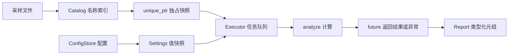

# SignalWorkbench · C++14 传感器采样分析台

这是学习完 **第 01～10 课和 6 节补充课**后的第二个综合练习。
第一份 [task_runner.cpp](../task_runner.cpp) 适合熟悉单文件执行流程；
本项目进一步练习头文件、实现文件、输入文件、自检程序之间的协作。

你会读到一个完整流程：导入传感器采样 → 建立名称索引 → 取得配置和数据快照 →
提交拥有数据的异步任务 → 计算统计量和一个复数频率分量 → 按类型读取、输出报告。
代码只使用 C++14 及之前的语言和标准库，不依赖第三方库。

先运行默认演示，再按 [逐步阅读与练习指南](STUDY_GUIDE.md) 阅读。

## 1. 场景与数据流

每条采样有一个名称和若干实数值。配置选择校准倍率，并决定是否计算频率分量。
目录保存原始数据；工作线程只使用独占的副本和按值捕获的配置。



这里不涉及驱动、网络、数据库或业务系统。运行只读取可选输入文件，并向终端输出。
工作线程数量限制为 1～4，样本目录最多 16 条，每条最多 4,096 个采样。

## 2. 文件安排与阅读顺序

| 顺序 | 文件 | 要理解的内容 |
|---|---|---|
| 1 | [src/main.cpp](src/main.cpp) | `main → run`，从整体流程出发 |
| 2 | [include/signal_lab/model.h](include/signal_lab/model.h) | 配置、采样、代理与报告类型 |
| 3 | [src/workbench.cpp](src/workbench.cpp) | 输入解析、快照、目录、计算和输出 |
| 4 | [include/signal_lab/tuple_tools.h](include/signal_lab/tuple_tools.h) | 索引序列如何展开元组 |
| 5 | [include/signal_lab/executor.h](include/signal_lab/executor.h) / [src/executor.cpp](src/executor.cpp) | 任务所有权、条件变量、关闭与异常传递 |
| 6 | [tests/self_test.cpp](tests/self_test.cpp) | 对照规则检查边界与并发行为 |

`[01]`、`[05A]` 等源代码注释标记对应课程，便于全文检索。
先读正常流程，再读异常路径；不需要一开始就逐行展开所有模板。

## 3. 编译运行

### Windows：本机 MinGW + Ninja

在 PowerShell 进入本项目目录：

```powershell
cd D:\my_project\DailyLearning\ModernCPP\CPP14\Practice\SignalWorkbench
cmake -S . -B build -G Ninja -DCMAKE_CXX_COMPILER=g++ -DCMAKE_BUILD_TYPE=Debug
cmake --build build -j 2
.\build\signal_workbench.exe
.\build\signal_self_test.exe
ctest --test-dir build --output-on-failure
```

也可以显式指定本机编译器：`-DCMAKE_CXX_COMPILER=C:/msys64/mingw32/bin/g++.exe`。
构建目录由本项目 `.gitignore` 排除。

### Linux/macOS

```bash
cmake -S . -B build -DCMAKE_BUILD_TYPE=Debug
cmake --build build -j 2
./build/signal_workbench
ctest --test-dir build --output-on-failure
```

CMake 将标准设为 C++14 并关闭语言扩展；GCC/Clang 另启用 `-pedantic-errors`。
本次实际验证环境是 Windows、MinGW g++ 15.1.0；其他平台需要在对应环境验证。

## 4. 第一次运行应该观察什么

无参数运行会使用内置的三条采样，并执行一次明确的掩码修改演示：
只关闭 `pulse "A"` 任务快照的第 1 号位置，目录中的原始采样保持不变。

```text
Roster: same_order=false same_members=true common_prefix=0
Mask edit: task=false catalog=true
```

报告的关键数值如下；输出按名称排序，与工作线程完成的先后顺序无关。

| 名称 | 选中数量 | 平均值 | RMS | 第 1 个频率分量 |
|---|---:|---:|---:|---|
| alternating | 4 | 0 | 1 | 约为 0 + 0i |
| pulse "A" | 3 | 0 | 0.816497 | 约为 2 + 0i |
| steady | 4 | 2 | 2 | 约为 0 + 0i |

每条报告还有 `elapsed=...us`，它来自单调时钟，数值会变化；不要断言某个固定耗时。
最后应看到 `25ms = 25000us` 和 `Completed: 3/3`。
接近零的浮点误差仅在显示时归零，报告中的实际值不被修改。

## 5. 使用自己的输入

```powershell
.\build\signal_workbench.exe data/demo.signals data/demo.settings
```

文件模式不自动修改选择掩码，所以示例文件里的 `pulse "A"` 为 4 个选中点，
RMS 约为 0.707107。这样可以区分“原始输入结果”与“副本修改演示结果”。

### 采样文件

见 [data/demo.signals](data/demo.signals)。每条记录占一行：

```text
"名称" 采样数 值0 值1 ...
"steady" 4 2 2 2 2
"pulse \"A\"" 4 1 0 -1 0
```

- 名称必须双引号包裹；`std::quoted` 支持引号和反斜杠转义。
- 空行、以 `#` 开头的注释行可以跳过；不接受行尾附加字段。
- 名称不得为空、重复或含零字符；每个名称最多 80 字节。
- 数值须有限且绝对值不超过 1,000,000；不接受空采样或数量不匹配。
- 数字样本是数值；将字符范围传给 `make_series` 时，字符也按其数值处理，
  不会把文本 `"123"` 自动解析成整数 123。

### 配置文件

见 [data/demo.settings](data/demo.settings)：

```text
"批次标题" 倍率索引 功能位 取得配置快照的超时毫秒数
"C++14 \"lab\"" 0 3 25
```

| 字段 | 允许范围 |
|---|---|
| 倍率索引 | 0、1、2、3，分别对应 1、2、4、8 倍 |
| 功能位 | `0b01` 表示统计；`0b10` 表示附加频率分量；当前统计必选，所以使用 1 或 3 |
| 快照等待上限 | 0～5,000 毫秒；这是等待读锁的上限，不是分析任务的执行超时 |

配置以一个完整对象解析，配对的 quoted 也可以保存标题中的换行；它不是逐行 CSV。
调用 `reload` 解析失败时，原配置保持不变。

## 6. 课程覆盖对照

覆盖范围是本仓库的 **10 节主线课 + 6 节补充课**。
它不声称演示 C++14 标准中的每一项历史缺陷修正。

| 课程 | 在项目中的使用位置 |
|---|---|
| 01 泛型 lambda、初始化捕获 | `Catalog::names`、`analyze`、`print_report`；`Executor::submit` 移动捕获快照 |
| 02 constexpr 增强 | `GainTable`、`make_gain_table`：循环生成倍率表并静态断言 |
| 03 变量模板、integer_sequence | `is_sample_v`、`pi_v`；`visit_tuple` 用 `make_index_sequence` 展开 |
| 04 make_unique、所有权 | `make_series`、`Catalog::snapshot` 与 `Executor::submit` 的所有权交接 |
| 05 exchange、quoted、_t | `shutdown` 转移 join 责任；配置和名称的 quoted；SFINAE 类型别名 |
| 06 shared_timed_mutex | `ConfigStore` 和 `Catalog` 的读写锁、超时取配置与独立快照 |
| 07 decltype(auto)、返回类型推导 | `Series::samples/selected`、`Report::summary`、lambda 返回类型 |
| 08 时间字面量 | `0ms`、`100ms`、`5s` 和 `25ms → microseconds`；耗时使用 steady_clock |
| 09 二进制、数字分隔符、deprecated | 功能位、容量上限、`try_snapshot_ms` 旧接口 |
| 10 get<T> | `ReportRow` 中按 `SignalName`、`BatchTitle`、`Summary`、`Spectrum` 取字段 |
| 02A 聚合与默认成员初值 | `Settings{"double", 1}`、`Summary{...}`、`RosterComparison{...}` |
| 03A 类型萃取与 SFINAE | `sample_type_t`、`enable_if_t`、`is_sample`；自检中的候选检测和 `is_final` |
| 05A 透明比较器与异构查找 | `map<string, Series, less<>>`，用 `const char*` 查目录 |
| 05B 非成员迭代器、双范围算法 | `make_series` 接数组与容器；名单比较的 equal/mismatch/is_permutation；反向索引 |
| 07A 转发与代理 | `selected` 返回代理值，`samples/summary` 保留引用，元组访问转发值类别 |
| 08A 字符串与复数字面量 | main 中 `"..."s`、analyze 中 `0.0i`；自检验证带零字符的字符串往返 |

`std::thread`、`future`、`packaged_task`、条件变量等来自 C++11，属于项目基础设施。
代码没有使用 C++17 的结构化绑定、`std::apply`、折叠表达式、`std::void_t`、
`std::string_view`，也没有使用 C++20/23 的线程和函数包装类型。

## 7. 自检的通过条件

`signal_self_test` 有 10 组自检，全部通过时打印 `Tests: 10/10 passed` 并返回 0。
除统计量外，还检查非法输入不发布、快照隔离、异常经过 future 传递、
关闭时排空任务、并发更新配置时字段一致，以及空元组的遍历边界。

CTest 额外执行内置演示和文件导入演示，共 3 项检查。
这是有界的教学线程池：没有任务抢占、超时取消、线程动态扩缩容或生产级调度器。
队列最多等待 32 个任务，关闭/析构由唯一所有者线程调用，任务提交可以并发。
传入 `submit` 的 `unique_ptr` 按值接收，调用发生时就转移所有权，提交抛异常也不会
把原指针自动退还调用方。

接下来阅读 [STUDY_GUIDE.md](STUDY_GUIDE.md)，按检查点手动追踪一次完整任务。
返回 [课程总目录](../../../README.md)。
