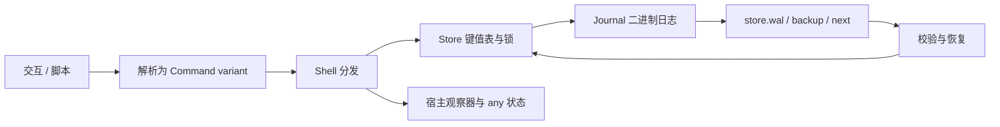

# MiniKV17：C++17 持久化键值存储

这是完成 **CPP17 第 11～30 课，全部 20 个主线知识点**后的综合项目。
它提供可嵌入 C++ 程序的存储库，以及一个支持交互和脚本的命令行客户端。
可用于理解本地配置库、缓存、计数器和小型存储引擎的基础结构。

项目使用 C++17 标准库，默认不依赖第三方库。库与客户端 **1485 行**，测试 526 行，
合计 **2011 行**；统计包含注释与空行，不含文档和 CMake。
排版参照 ArchDesign 课件：函数之间留白，函数内部按逻辑阶段分段，优先保证阅读清晰。
先运行演示，再跟随 [STUDY_GUIDE.md](STUDY_GUIDE.md) 逐步阅读。

## 1. 能完成什么

| 功能 | 行为 |
|---|---|
| 类型化读写 | 值支持字符串、`int64_t` 和布尔，保留实际类型 |
| TTL | 可选的秒级生存时间，日志保存绝对时间，重启不会重新续期 |
| 原子计数器 | `incr` 在一个锁内完成读改写，检查有符号溢出，保留原 TTL |
| 查询 | 单键查询、字典序前缀扫描；返回拥有数据的副本 |
| 删除与重命名 | 重命名保留值与 TTL，目标已存在时拒绝覆盖 |
| 持久化 | 每次变更先追加二进制日志并刷新，再发布到内存 |
| 恢复 | 启动重放日志；修剪未完成的尾记录，拒绝校验失败的完整记录 |
| 压缩 | 将当前有效数据重写成新日志，通过备份文件处理切换中断 |
| 并发访问 | 一个 Store 对象支持多线程调用，共享读锁与独占写锁 |
| 指标与扩展 | 数据统计、读命中、会话审计；宿主可注册自定义 `any` 状态和观察器 |



一个数据库目录同时只能由 **一个进程中的一个 Store 对象**拥有。
项目没有实现跨进程文件锁；并发支持指多个线程共享同一个对象。

## 2. 编译和第一次运行

### Windows / PowerShell

从本仓库根目录运行：

```powershell
cmake -S CPP17/practice/MiniKV17 -B CPP17/practice/MiniKV17/build -G Ninja -DCMAKE_BUILD_TYPE=Debug
cmake --build CPP17/practice/MiniKV17/build -j 4
ctest --test-dir CPP17/practice/MiniKV17/build --output-on-failure

.\CPP17\practice\MiniKV17\build\minikv.exe --dir CPP17/practice/MiniKV17/build/demo-db --script CPP17/practice/MiniKV17/data/demo.kv
```

本机默认编译器是 MinGW g++ 15.2.0。也可在 VS 开发者终端中使用 MSVC 的 CMake 生成器；
本次实际验证平台为 Windows / MinGW 与 WSL Ubuntu / GCC，未在 MSVC、macOS 实测。

### Linux / WSL

```bash
cmake -S CPP17/practice/MiniKV17 -B /tmp/minikv17-build -DCMAKE_BUILD_TYPE=Debug
cmake --build /tmp/minikv17-build -j 4
ctest --test-dir /tmp/minikv17-build --output-on-failure
/tmp/minikv17-build/minikv --dir /tmp/minikv17-demo --script CPP17/practice/MiniKV17/data/demo.kv
```

演示会写入 `service.name`、`service.workers`、`service.ready`，读取并扫描后压缩日志。
可以重复运行：三个键会被覆盖，其他已有键会保留。
全新数据库中的关键输出如下：

```text
VALUE string "MiniKV17"
service.name string "MiniKV17"
service.ready bool true
service.workers int 4
ROWS 3
STATS keys=3 bytes=17 writes=3 reads=1 hits=1 replayed=0 compactions=0 discarded_tail=0 faulted=0
OK compacted
BYE
SESSION commands=8 errors=0
```

再次运行时 `replayed` 会变化；`writes`、`reads`、`hits`、`compactions` 是当前打开实例的指标。
`bytes` 是有效值的逻辑字节数：字符串取长度，整数取 8，布尔取 1，不表示磁盘大小。

## 3. 自己操作数据库

省略 `--script` 后，程序从标准输入按行读取命令；不带参数时目录是当前目录下的
`minikv17-data`，可用 `--dir` 指定数据目录。

```powershell
.\CPP17\practice\MiniKV17\build\minikv.exe --dir CPP17/practice/MiniKV17/build/my-db
```

输入：

```text
put app.name string "C++17 storage lab"
put jobs.done int 0
incr jobs.done 3
put app.enabled bool true
put session/token string "temporary token" 30
get jobs.done
rename app.name app.title
scan app.
stats
compact
quit
```

重启同一个目录，再执行 `get jobs.done`，仍应得到 `VALUE int 3`。
`session/token` 在写入 30 秒后变成缺失；演示 TTL 不依赖测试中真实等待。

| 命令 | 说明 |
|---|---|
| `put KEY string VALUE [TTL]` | 创建或覆盖字符串；空串写成 `""` |
| `put KEY int VALUE [TTL]` | 严格解析完整的十进制 `int64_t` |
| `put KEY bool true\|false [TTL]` | 布尔值不与整数混用 |
| `get KEY` | 返回 `VALUE ...` 或 `MISSING`；缺失是正常查询结果 |
| `incr KEY DELTA` | 缺失时按整数 0 创建；已有非整数或溢出时失败 |
| `erase KEY` | 删除有效键；缺失时报告错误 |
| `rename OLD NEW` | 不覆盖已有有效目标；同名操作在源存在时成功 |
| `scan [PREFIX]` | 按键排序返回当前有效数据 |
| `stats` / `compact` | 查看统计 / 压缩日志 |
| `help` / `quit` | 显示帮助 / 停止读取后续命令 |

键长为 1～128 字节，只允许 ASCII 字母、数字、`_`、`-`、`.`、`/`，区分大小写。
最多保存 10000 个有效键，单个字符串最多 65536 字节；键只是名称，不被拼接成文件路径。
TTL 必须为正整数秒，不接受加号、空白、溢出或数字后的杂字符。
`put` 不传 TTL 会清除旧 TTL；`incr` 和 `rename` 保留已有 TTL。

字符串包含空格时使用双引号，支持 `\\`、`\"`、`\n`、`\r`、`\t`、`\xHH` 转义。
值按字节保存，可通过 `\x00` 表示零字节；控制字节在输出时转义。
空行与首个非空白字符为 `#` 的行跳过，不支持行尾注释。

退出码：`0` 表示会话成功；`1` 表示至少一条命令或观察器失败；`2` 表示启动或输入 I/O 错误。
命令错误会输出带序号的 `ERR`，随后继续处理；`quit` 后的输入不再执行。

## 4. 二十个知识点落在哪里

源码中的 `[11]`～`[30]` 注释与课程编号对应。第 19 课是建模取舍，因此会贯穿多个类型。

| 课 | 知识点 | 项目中的用途 |
|---|---|---|
| 11 | 结构化绑定 | `Store::commit` 拆解预分配节点，扫描与统计遍历键值对，拆解 charconv 结果 |
| 12 | if / switch 初始化语句 | 解析数值、查询 map、访问 variant 分支时缩小临时变量作用域；本项目采用 if 形式 |
| 13 | if constexpr | `scalar_text` 和访问器按真实类型编译；字符串不实例化整数转换 |
| 14 | 折叠表达式 | `line` 将不同类型参数串成输出行 |
| 15 | CTAD | `scoped_lock`、`shared_lock`、`lock_guard` 和命令参数 `tuple` |
| 16 | optional | 缺失查询、无 TTL、数值解析成功或失败 |
| 17 | variant / visit | 类型化值、命令集合、日志操作，以及成功/错误结果 |
| 18 | any | `Shell::observe` 接受宿主自选的审计状态，指针版 `any_cast` 检查实际类型 |
| 19 | 三者取舍 | 查询缺失用 optional；固定类型和错误集合用 variant；开放宿主状态用 any |
| 20 | string_view | 解析输入、键与前缀查询只借用；返回的 Command、Entry、Row 拥有数据 |
| 21 | filesystem | 目录创建、日志大小、尾部修剪、压缩与备份切换 |
| 22 | 属性增强 | `[[nodiscard]]` 标记必须检查的结果；`[[maybe_unused]]` 标记统计中的部分未用绑定 |
| 23 | scoped_lock / shared_mutex | 并发查询、独占写入、数据与独立读指标的一致快照 |
| 24 | charconv | CLI 的整数/TTL 解析、日志中的整数文本编码；检查错误码和结束位置 |
| 25 | 执行策略与归约 | `Store::stats` 在锁外对值长度执行 `transform_reduce`，默认 seq，可选 par |
| 26 | inline 变量 / ODR | 公共头文件中的版本与容量常量被多个翻译单元共享 |
| 27 | 强制拷贝消除 | `Store::open` 返回不可复制、不可移动的 Store 纯右值 |
| 28 | 求值顺序 | 错误输出的 `<<` 链先记录错误再读取错误文本；解码分步读取，避免误用实参顺序 |
| 29 | invoke / apply | `Shell::execute` 调成员函数，tuple 拥有 put 参数，观察器统一调用 |
| 30 | byte / 节点句柄 / try_emplace | 显式小端编码；预分配节点后提交；重命名修改节点键并保留值 |

无需为了展示语法制造无意义的 fallthrough；这节属性课的实际使用是结果诊断与未用声明标记。
线程、流、map、条件判断等 C++11/14 基础同样参与项目，不会因为来自旧标准就避开。

## 5. 文件与运行约束

代码使用 4 空格缩进，控制分支显式使用花括号；函数、类型和独立接口之间留空行。
函数内部按校验、准备、执行和收尾组织段落，同一目的的连续语句保留在一起。
项目的 `.clang-format` 固定基础排版规则，逻辑段落的留白由维护者根据职责保留。

| 文件 | 职责 |
|---|---|
| [include/minikv/model.hpp](include/minikv/model.hpp) / [src/model.cpp](src/model.cpp) | 值、命令、错误、解析与格式化 |
| [include/minikv/store.hpp](include/minikv/store.hpp) / [src/store.cpp](src/store.cpp) | 公共存储 API、TTL、锁、写入提交、统计 |
| [include/minikv/journal.hpp](include/minikv/journal.hpp) / [src/journal.cpp](src/journal.cpp) | 字节编码、校验、恢复与压缩 |
| [include/minikv/shell.hpp](include/minikv/shell.hpp) / [src/shell.cpp](src/shell.cpp) | 命令分发、输出、宿主观察器 |
| [src/main.cpp](src/main.cpp) | 参数、脚本、审计扩展与退出码 |
| [tests/self_test.cpp](tests/self_test.cpp) | 14 组独立自检 |

`flush()` 刷新 C++ 流缓冲区，**不承诺断电持久性**。项目未调用 `fsync` / `FlushFileBuffers`，
也未同步目录项。压缩协议和测试覆盖正常关闭、文件切换现场与可识别的截断记录，
不能据此声称覆盖所有操作系统崩溃和硬件写入重排。

写日志发生 I/O 错误时结果可能不确定，实例进入 faulted 状态并拒绝后续写入，需要关闭重开。
读取仍返回该实例最后确认的内存状态。完整帧的头部或载荷校验失败时启动报错，
不擅自回滚到旧备份；FNV-1a 用于意外损坏检测，不提供防篡改保证。

TTL 使用 Unix 墙上时钟；系统时间回拨会影响可见性，已经被清理/压缩移除的数据不会恢复。
可注入的 Clock 必须允许并发调用。扫描与统计各自形成快照，多次 API 调用之间不提供事务隔离。
恢复阶段暂存完整日志操作，长时间运行应定期 `compact` 控制日志与恢复内存开销。
项目暂未包含网络协议、多键事务、MVCC、后台压缩或自动过期线程。

Shell 由一个线程驱动；观察器在 Store 释放锁后同步调用，可使用任意可复制的 `any` 状态。
观察器失败会使会话返回错误，但不会撤销已经提交的命令；观察器应避免递归驱动同一 Shell。

## 6. 验证与可选并行策略

`minikv_tests` 应打印 `Tests: 14/14 passed`。测试覆盖数值边界、二进制值往返、TTL 重启、
快照隔离、容量限制、重命名冲突、日志截断与损坏、压缩切换现场、失败后的写屏障、
并发写入、原子计数器、命令分发和 `any` 审计。
测试使用独占临时目录和注入时钟，不等待 TTL 的真实秒数，不修改演示数据库。

最终版本已在 Windows / g++ 15.2.0 和 WSL Ubuntu / GCC 13.3.0 通过全部测试。
WSL 验证同时启用了 AddressSanitizer、UndefinedBehaviorSanitizer，
并使用 `-fno-elide-constructors`，验证工厂返回不依赖可选拷贝消除。

本机 Windows / MinGW 的初次并发加锁曾触发 `shared_mutex` 内部断言，
上游存在[相同症状的问题记录](https://github.com/msys2/MINGW-packages/issues/25193)。
结合其延迟初始化实现，构造函数在发布对象前完成一次独占加锁作为兼容处理；
处理后本机连续 30 轮原有测试通过。这是本机验证结果，不表示已证明所有 MinGW 版本的根因。

默认 `std::execution::seq` 易于复现，归约回调无锁、无 I/O、无分配且声明 `noexcept`。
安装匹配的 TBB 后，可在支持该后端的环境尝试：

```powershell
cmake -S CPP17/practice/MiniKV17 -B CPP17/practice/MiniKV17/build-par -G Ninja -DMINIKV17_PARALLEL=ON
cmake --build CPP17/practice/MiniKV17/build-par
ctest --test-dir CPP17/practice/MiniKV17/build-par --output-on-failure
```

此选项选择 par，不保证实际并行或速度提升；本次未验证 TBB 后端。
本项目不是性能基准，小数据集的快照复制与调度成本可能超过归约本身。

返回 [C++17 练习目录](../README.md) · [课程总目录](../../../README.md)。
