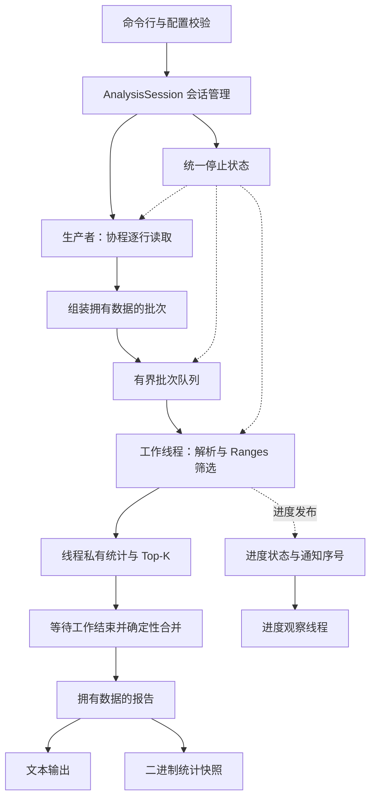

# TraceLab20：C++20 本地日志分析引擎设计

本文保留最初的工程设计与阶段规划。已交付的命令、构建方法与接口见 [项目说明](README.md)，各课对应的源码见 [课程对照表](docs/COURSE_MAP.md)。

## 1. 项目目标与课程范围

编写一个命令行工具：读取多个本地日志文件，按条件筛选事件，并行计算统计量，
生成可复现的时间线、组件统计和耗时报告；分析过程中可以查看进度、请求取消。

学习目标是把 C++20 的接口约束、惰性计算、所有权、协作取消、编译期计算和模块组织，
组合成一条可以解释、测试和扩展的数据处理流程。

设计按用户已经完成全部 C++20 学习来制定。当前仓库大纲的 C++20 范围是第 31～48 课；
本次检查时磁盘上的课件为第 31～40 课，第 41～48 课以根 README 中的大纲为依据。
覆盖目标是这 18 节课的主题，不等同于覆盖 C++20 标准的每一项新增条款。

工程采用 C++20 与标准库，CMake 管理构建，初期以 Windows 上的本地工具链为验证环境。
项目逻辑以可移植代码为主。Modules 构建与命名时区作为完整项目的独立验收项。

## 2. 最终可以完成的事情

一个典型任务：分析数个客户端组件的日志，找出某个时间段内的错误、最慢的操作，
以及错误最集中的分钟，并保留原始文件名、行号供定位。

| 功能 | 具体行为 |
|---|---|
| 导入 | 读取明确指定的文件，或枚举目录内指定后缀的普通文件 |
| 筛选 | 时间区间、最低等级、组件集合、消息关键词、事件标记 |
| 时间线 | 返回时间最早或最晚的 K 条匹配事件，最终按规定顺序展示 |
| 统计 | 等级数量、组件数量、按 UTC 分钟分桶的事件数量 |
| 耗时分析 | 有耗时的事件数量、总耗时、最小值、最大值、平均值、最慢 K 条 |
| 并发 | 可配置工作线程数，采用有界批次队列 |
| 进度与取消 | 输出已读取、已处理、已匹配数量；支持 API 取消和 CLI 超时请求 |
| 报告 | 终端摘要、UTF-8 文本报告、可重新读取的二进制统计快照 |
| 时间显示 | 内部统一 UTC；展示支持 UTC、固定偏移和具备环境支持的命名时区 |

完整扫描的统计结果包含所有符合条件的有效事件，Top-K 仅限制展示明细数量。
不把“展示前 20 条”解释为“读到 20 条就完成了整个统计”。

规划中的使用方式：

```text
tracelab analyze --input ./logs --min-level warn --component network,policy --top 20
tracelab analyze --input ./logs --workers 4 --timezone Asia/Shanghai --report report.txt
tracelab analyze --input ./logs --timeout 5s
tracelab analyze --input ./logs --snapshot report.tl20
tracelab show-snapshot report.tl20 --timezone UTC
```

首版采用离线文件处理。输入文件应在分析期间保持稳定；目录枚举固定文件集合，
但不构成文件内容的一致性快照。暂不加入实时追踪、网络收集、数据库、GUI 或通用查询语言。

## 3. 输入协议与核心数据

先定义一个容易手工生成、便于严格检查的 UTF-8 行协议。每行包含 7 个字段，字段间为 Tab：

```text
timestamp<TAB>level<TAB>component<TAB>pid<TAB>flags<TAB>duration_us<TAB>message
```

例如下面用 `<TAB>` 显示真实文件中的 Tab 分隔符：

```text
2026-11-18T09:30:12.123456+08:00<TAB>WARN<TAB>network<TAB>1024<TAB>3<TAB>152000<TAB>连接重试
```

- 时间戳必须包含 `Z` 或明确的 UTC 偏移，小数秒接受 0～6 位；使用日历类型校验日期。
- 等级固定为 `TRACE / DEBUG / INFO / WARN / ERROR`。
- `pid`、`flags` 使用完整的无符号十进制解析；保留位必须为零。
- `duration_us` 为非负整数或 `-`，后者表示没有耗时数据；缺失与零不同。
- component 为非空 ASCII 标识，message 为 UTF-8；V1 字段内部不允许 Tab、CR、LF、NUL。
- 接受 LF / CRLF；文件开头可有 UTF-8 BOM；空行跳过，其余非空行必须遵循协议。
- 数值范围、记录长度、日期有效性与 UTF-8 合法性都在进入业务计算前检查。

| 类型 | 职责与所有权 |
|---|---|
| `SourcePosition` | 固定文件序号与从 1 开始的物理行号，标识记录来源 |
| `RawRecord` | 拥有一行输入字节和来源位置，允许移动进队列 |
| `Event` | 拥有规范化后的字段；时间为 `sys_time<microseconds>`，耗时为可选整数微秒 |
| `EventKey` | 按 UTC 时间、文件序号、行号排序，使用默认三路比较 |
| `QuerySpec` | 拥有筛选条件，启动会话后只读 |
| `Batch` | 拥有一批 RawRecord；在生产者、队列和工作线程之间转移 |
| `BatchSummary` | 一个完整批次的计数、分组、Top-K 候选与有限诊断 |
| `WorkerSummary` | 单个线程私有的累计结果 |
| `Report` | 拥有最终展示需要的数据，独立于输入缓冲区与工作线程存活 |
| `RunOutcome` | 完成、取消或失败，以及对应的报告、覆盖范围或错误信息 |

文件先按规范化后的路径键排序、去重，再分配文件序号。V1 不通过文件 ID 合并硬链接别名。
同一组稳定输入和同一查询，应得到与工作线程数量无关的结果顺序。
浮点平均值不参与事件排序；计数和总耗时以检查溢出的整数累计，最后才计算平均值。

## 4. 总体架构



| 层 | 主要组件 | 依赖规则 |
|---|---|---|
| 领域模型 | Event、QuerySpec、Report、错误类型 | 不依赖线程和命令行 |
| 输入与编码 | Generator、文本解析、UTF-8、时间转换、快照编解码 | 依赖模型；不负责线程调度 |
| 分析算法 | 条件筛选、分组累计、Top-K、结果合并 | 可以单线程独立测试 |
| 运行时 | 有界队列、AnalysisSession、进度通知 | 组合输入与算法，管理生命周期 |
| 应用入口 | 参数解析、报告输出、退出码 | 调用会话 API |

一条记录的主路径保持直观：拥有原始字节 → 校验并构建 Event → 判断是否匹配 → 更新统计。
泛型主要用于输入范围和累计器接口；不把每个业务类型都模板化。

## 5. 三个核心机制

### 5.1 协程负责按需读取

实现一个项目内的 `Generator<T>`，用 `co_yield` 逐条产出 RawRecord。
它拥有协程句柄，支持移动，不支持复制；提供输入迭代器与哨兵，满足单遍 `input_range`。

- 文件路径、读取缓冲和流对象的生命周期由生成器拥有的状态管理。
- 解引用得到的当前值只在下一次推进前有效；批次必须把值移动或复制成自己的记录。
- 提前结束消费时，销毁已挂起的协程帧并关闭文件。
- 协程内部异常存入 `exception_ptr`，在调用者推进时重新抛出。
- 不持有互斥锁跨越 `co_yield`，不允许两个线程同时恢复同一生成器。
- 生成器由生产者线程独占使用；普通文件读取仍然是同步 I/O。

C++20 提供协程语言机制，项目自己实现生成器封装；不使用 C++23 的 `std::generator`。

### 5.2 Ranges 负责批次内的查询表达

工作线程完成解析后，对本批拥有的 Event 集合构建过滤视图，表达等级、时间与关键词条件。
聚合器只遍历匹配视图一次。需要排序和保存的报告数据显式收集到拥有型容器。

主要组合包括：`filter` 筛选、`transform` 投影、`split` 拆分组件选项、
`keys / values` 遍历统计表、`take` 限制已排序报告的展示、`iota` 生成测试数据。
`ranges::sort` 使用字段投影处理具体报告行。

生命周期规则：批次的容器先存在，视图在其作用域内消费；不把引用局部数据的视图存进 Report。
过滤与投影函数保持无副作用，不把它们的调用次数当作业务计数。
生成器是单遍范围；多次查询重新扫描输入，不能反复遍历同一个生成器来获得相同数据。

全局最早/最晚 K 条采用有界堆，最慢 K 条按耗时和来源键建立全序。
每个线程保留自己的 K 个候选，最后合并这些候选得到全局 K 条。
对任一线程落在第 K 名之后的元素，该线程已至少有 K 个更优元素，因此无需进入全局候选。
候选只保留排序字段、来源和最多 512 字节的 UTF-8 消息预览；完整消息只参与当前记录的筛选。
预览在码点边界截断，并标明省略，避免 Top-K 长期保留大段日志正文。
首版不提供无限制的全量排序导出；完整排序需要额外的内存上限或外部归并设计。

### 5.3 线程负责并行与协作取消

先实现单线程参考路径，再使用 1 个生产者、W 个工作线程和 1 个进度观察线程。
线程对象由 `jthread` 托管，会话持有统一的停止源；所有阻塞等待和处理循环使用同一会话令牌。
生命周期管理不能只依赖各个 jthread 各自的停止状态，析构路径必须明确请求会话停止并等待线程。

生产者将批次移入有界队列；队列满时等待，以限制读取速度与内存增长。
工作线程取出批次后释放队列锁，再执行解析与计算；各线程只修改自己的 WorkerSummary。
最终由协调者等待工作线程退出，再合并结果，避免为每条记录争用一把全局统计锁。

队列等待采用支持停止令牌的 `condition_variable_any`。队列区分两种关闭方式：

| 原因 | 行为 |
|---|---|
| 输入正常耗尽 | 关闭提交入口，工作线程继续处理已入队批次，排空后退出 |
| 用户取消或致命错误 | 请求停止，唤醒等待者，舍弃未开始的批次，正在执行者在检查点退出 |

批次处理先形成临时 BatchSummary，完整完成后才提交到线程累计结果。
取消时若当前批次尚未提交，整个批次丢弃；已提交批次可以组成明确标为 Partial 的报告。
取消报告描述实际提交的数据子集，不声称是输入文件的一个连续前缀，也不声称统计完整。

停止检查安排在读取迭代、记录处理和批次提交前。超时表示到时请求取消，
不保证在精确时间内返回：正在阻塞的普通文件 I/O 无法靠停止令牌强制中断。

进度观察使用 `atomic::wait / notify_all` 等待一个递增的通知序号；统计快照由互斥锁保护。
先发布状态，再改变通知序号并通知；观察者读取序号、检查状态，再等待该序号变化。
正常完成、取消和失败都必须发布终态并改变序号，保证观察线程退出。
只调用 notify 而不改变被等待的值，不能构成关闭协议；序号也不应在会话期间循环复用。
该约束依据 [C++20 草案的原子等待规则](https://timsong-cpp.github.io/cppwp/n4861/atomics.wait)。

## 6. 第 31～48 课怎样落到工程中

| 课程 | 工程中的用途 | 需要理解的边界 |
|---|---|---|
| 31 Concepts | 用标准范围概念约束输入；定义 Accumulator，要求接受 Event、合并同类结果、产出统计 | 概念检查接口形状，合并的结合性等语义由测试验证 |
| 32 Ranges 算法 | 报告行按字段投影排序、查询、验证 | 排序需要适合的可变随机访问范围 |
| 33 惰性视图 | 将多个筛选条件组合成批次内查询 | 借用的对象必须活着；惰性求值不等于缓存 |
| 34 视图组合 | 组件参数 split、字段 transform、统计表 keys/values、报告 take、测试 iota | 只在对应业务中使用适合的视图 |
| 35 三路比较 | EventKey、SourcePosition、快照版本的值比较 | 事件排序键不包含浮点统计值 |
| 36 format | 对齐报表、错误消息、自定义等级或来源位置格式化 | UTF-8 编码与终端显示仍由输出边界处理 |
| 37 span | 批次分析接受 `span<const RawRecord>`；快照解码接受 `span<const byte>` | 借用不延长寿命；读取前自行校验长度 |
| 38 jthread / stop_token | 工作线程、统一取消、可停止的队列等待 | 停止是协作协议，正常结束要排空队列 |
| 39 协程 | 手写 Generator，按需读取日志并管理资源 | 单遍消费、异常转交、句柄与帧的唯一所有权 |
| 40 consteval / constinit / source_location | 编译期生成字段描述表；常量初始化进程级原子会话编号；内部诊断记录调用位置 | constinit 不代表只读或线程安全；输入行号另用 SourcePosition |
| 41 模板 lambda / 指定初始化 / likely | 类型化字段转换分发；明确构建 QuerySpec；解析成功路径保留 likely 实验 | 指定初始化遵守声明顺序；likely 的效果通过测量判断 |
| 42 bit 家族 | popcount 统计事件标记数量；endian 选择字节序转换；bit_cast 编码快照中的浮点均值 | wire format 固定小端，不直接写整个 C++ 对象布局 |
| 43 erase / erase_if | 报告展示副本中按选项删除零命中行，或从输入候选集合删除排除项 | 删除前结束相关视图遍历，不影响原始计数 |
| 44 constexpr string / vector | 在编译期临时规范化字段名、检查重复、构造字段描述表 | 临时动态存储在常量求值内释放，产物为拥有数据的固定数组 |
| 45 atomic 等待与通知 | 进度观察者等待通知序号变化，避免轮询 | 数据发布、唤醒条件和退出路径必须一起设计 |
| 46 char8_t / Unicode | UTF-8 文字与 UTF-8 类型边界、中文日志的验证与往返 | char8_t 不自动验证编码，也不提供 Unicode 归一化 |
| 47 Modules | 以命名模块导出领域模型，构建导入该模型的 CLI 版本 | 模块依赖扫描与编译器相关，单独验收实际构建 |
| 48 chrono 日历与时区 | 日期有效性、UTC 标准化、时间桶、命名时区显示 | 内部排序按 UTC，显示时区与统计口径分开 |

第 40 / 44 课的编译期部分围绕同一份字段表展开：输入是编译期字段定义，
用临时 string/vector 进行校验与整理，输出固定大小且拥有字段名字节的描述表。
不返回指向临时字符串的 string_view。运行时格式错误仍走运行时错误处理。
这种临时动态分配必须在常量求值内释放，见 [C++20 常量表达式规则](https://timsong-cpp.github.io/cppwp/n4861/expr.const)。

C++17 中的 optional、variant、filesystem、from_chars 等继续用于基础设施。
项目不使用 C++23 的 expected、ranges::to、views::chunk、print 或 byteswap。
批次构造、结果类型与小端编码在 C++20 范围内实现。

## 7. UTF-8、时间与二进制快照

### UTF-8

外部日志与文本报告采用 UTF-8。I/O 字节与 `u8string / u8string_view` 之间通过集中定义的边界转换，
不把 char8_t 指针随意传给要求 char 指针的接口。

关键词匹配定义为合法 UTF-8 文本上的精确编码序列匹配，支持中文原文查找。
首版不提供不区分大小写的 Unicode 搜索、规范等价匹配或字素计数。
报告若需要截断消息，必须落在 UTF-8 码点边界；中文不参与依赖固定字符宽度的表格填充。
Windows 文件路径使用 filesystem::path 的原生路径能力，命令行参数与终端输出适配集中在入口层。

### 时间

输入必须明确给出偏移，转成 UTC 后用于筛选、排序和分桶，区间约定为左闭右开 `[from, to)`。
V1 采用 POSIX 风格时间线，不接受闰秒 `:60`；历法检查使用 year_month_day 等类型。
处理耗时和超时使用 steady_clock，与日志的事件时间分开。

分钟桶按 UTC 的整分钟划分，展示标签再转换到用户选定时区，并保留偏移。
因此夏令时回拨时两个本地标签相似的桶仍能区分。
按“某地日历日”汇总会涉及 23/25 小时的日期，留作后续独立扩展。

UTC 和固定偏移显示不依赖命名时区数据库。用户明确指定命名时区时，
若运行库缺少可用数据库或找不到该区域，返回清晰错误，不悄悄换用其他时区。
时区数据库访问本身存在失败路径，见 [C++20 时区数据库接口](https://timsong-cpp.github.io/cppwp/n4861/time.zone.db.access)。

### 二进制统计快照

快照用于保存和重新展示已完成分析的统计结果，包含查询摘要、统计计数、时间范围和分组行。
它不是完整原始事件库，不能用于执行任意新的原始事件查询。

格式计划包含 magic、版本、标志、载荷长度、统计字段与长度前缀 UTF-8 文本，整数固定小端。
均值采用明确约定的 IEEE 754 binary64，通过 bit_cast 转换为字节数组，
再根据 endian 转换为协议要求的小端顺序；构建时检查 double 表示条件和所支持的宿主字节序。
解码时检查长度上限、版本、枚举值与数值有效性。
原始计数和总耗时一并保存，均值可重新计算并验证，避免派生值成为唯一依据。

不直接写出结构体，不依赖内存填充和宿主字节序，不声称该格式具有防篡改能力。
取消或失败的会话不生成“完整快照”；文本部分报告必须明确标识 Partial。

## 8. 错误、资源上限与可复现性

| 情况 | 决策 |
|---|---|
| 空输入文件、没有匹配 | 正常完成，报告为零条 |
| 单行字段错误或非法 UTF-8 | 默认计数并跳过；保留按来源位置排序的前 100 条诊断 |
| 严格模式遇到格式错误 | 请求整体停止，状态为 Failed |
| 文件打开/读取失败 | Failed，不把读取失败当作空文件 |
| 配置错误、资源上限、整数溢出 | 明确失败，避免静默截断统计 |
| 用户取消或超时请求 | Cancelled，可展示已提交批次的 Partial 报告 |
| 内存分配等异常 | 在线程边界捕获并传播失败，触发收尾；不让异常逃出线程入口 |
| 报告写入失败 | 返回失败，不声称输出已成功保存 |

CLI 计划区分：0=完整成功，1=完整扫描但跳过了坏记录，2=失败，3=取消。
严格模式将坏记录提升为失败。无匹配属于完整成功。
致命错误与取消并发发生时，最终状态以 Failed 为准；由协调者统一发布终态，
保留一个实际捕获的首个致命错误，不承诺并发失败时错误文本的选择顺序固定。

建议的初始上限：工作线程 1～8，批次同时限制为 256 条、1 MiB 原始字节，队列 2W 个批次，
单行最多 64 KiB，文件数最多 10,000，组件数最多 1,024，分钟桶最多 10,000，Top-K 最大 1,000。
这些是教学工程的可配置边界，不是性能指标；参数在启动阶段检查。
读取器在累积字节时检查行长，不能先无界 getline，再在整行分配后检查。

内存量由文件清单、在途批次、每线程统计表、Top-K 和有限诊断组成。
流式读取只能约束原始记录缓冲，分组数量和报告候选也必须分别有上限。
单线程与多线程的完整结果要求计数、总耗时、Top-K 和排序一致；运行耗时与进度输出不要求一致。
取消发生在不同调度时刻，部分报告的数据子集可以不同，状态和覆盖说明必须准确。

正常关闭顺序：结束生产 → 关闭队列入口 → 排空并等待工作线程 → 合并 → 发布进度终态 → 等待观察线程。
失败/取消顺序：请求统一停止 → 中止队列并唤醒 → 等待生产者与工作线程 → 发布终态 → 等待观察线程。
销毁共享状态之前，所有访问它的线程都必须结束；不在持有队列锁时 join 或执行用户代码。

## 9. 工程目录与 Modules 策略

以下是设计阶段的目录草案。实际实现将关系紧密的接口合并在同一个文件中。

```text
TraceLab20/
  DESIGN.md
  README.md
  STUDY_GUIDE.md
  CMakeLists.txt
  include/tracelab/
    model.hpp
    generator.hpp
    parser.hpp
    query.hpp
    aggregate.hpp
    bounded_queue.hpp
    session.hpp
    progress.hpp
    diagnostics.hpp
    schema.hpp
    snapshot.hpp
    utf8.hpp
    time.hpp
  src/
    main.cpp
    parser.cpp
    query.cpp
    aggregate.cpp
    session.cpp
    snapshot.cpp
    report.cpp
    utf8.cpp
    time.cpp
  modules/
    tracelab.model.cppm
  tests/
    parser_tests.cpp
    query_tests.cpp
    generator_tests.cpp
    session_tests.cpp
    snapshot_tests.cpp
    compile_fail/
  data/
    demo.log
    malformed.log
    expected_report.txt
  docs/
    COURSE_MAP.md
    FILE_FORMAT.md
```

先建立常规头文件构建路径。之后提供命名模块 `tracelab.model`，从同一份领域模型声明导出 API，
让单独的应用构建目标真实使用 import；用同一组行为测试验证两种构建结果。
模块方案在小型构建验证中先确定声明归属和可达性，再接入应用，避免复制一套易漂移的类型定义。
同一目标内不混合两种具有不同模块归属的同名类型定义。

标准库使用头文件；本项目的 C++20 Modules 学习目标是自定义命名模块。
模块目标能力不足时明确报为未验证，主线仍可继续学习；只有模块目标也通过后，才算完成第 47 课验收。

本次只查询到本机 g++ 为 MSYS2 15.2.0、CMake 为 4.2.0-rc1，没有编译验证本设计。
正式实现前做 format、atomic wait、时区和模块构建的能力检查。
CMake 的模块依赖扫描受编译器和生成器组合约束，Ninja 还存在版本要求，
见 [CMake 4.2 Modules 文档](https://cmake.org/cmake/help/v4.2/manual/cmake-cxxmodules.7.html)。
仅凭编译器版本号，不宣称全部能力已经可用。

## 10. 分阶段实现与验收

| 阶段 | 产出 | 验收条件 |
|---|---|---|
| 0 工具链探测 | C++20 构建、关键库能力记录、模块小型验证 | 明确主线工具链与完整验收工具链 |
| 1 单线程闭环 | 模型、UTF-8 行解析、基础过滤、文本报告 | 示例输入得到手工可计算的预期报告 |
| 2 查询与统计 | Ranges 管道、分组、时间桶、Top-K、span 接口 | 与简单参考算法比较完整结果，边界条件一致 |
| 3 协程输入 | Generator 替换基础读取路径 | 正常耗尽、提前停止、移动与异常传播均正确 |
| 4 并发运行 | 有界队列、jthread、会话停止与进度通知 | 多线程结果与单线程一致，取消/失败不会死锁 |
| 5 工程完善 | 编译期字段表、二进制快照、时区显示、诊断 | 快照往返、坏输入、命名时区与编译期约束通过 |
| 6 模块与教学交付 | 命名模块应用目标、学习指南、课程覆盖表 | 两种构建行为一致，18 节课均有实际用途及验收记录 |

建议正文实现以约 2,500～3,500 行为目标，测试与教学材料单独计算；这是初步规模估算。
如果 UTF-8、模块兼容或快照细节超出预算，应拆阶段，不靠压缩代码和删除关键检查维持行数。
每个阶段都形成可运行的版本，阅读顺序与阶段顺序一致。

函数与类型之间留空行，函数内部按校验、准备、处理、收尾分段；注释解释所有权和不变量。
源代码用 `[31]`～`[48]` 标记对应知识点，STUDY_GUIDE 通过问题引导追踪一条事件和一次取消。

## 11. 需要认真验证的边界

1. 解析：空输入、CRLF/BOM、无末尾换行、超长行、非法日期、数值溢出、缺失字段、UTF-8 截断。
2. 查询：时间边界、无匹配、同一时间戳、多条件组合、缺失耗时与零耗时。
3. Top-K：K=0/1/上限、重复排序值、乱序文件；与完整排序参考结果比较。
4. 协程：只消费一条就销毁、移动后的对象、正常耗尽、异常、不得重复恢复已完成协程。
5. 并发：队列空时取消、队列满时取消、处理中取消、正常 EOF 排空、线程启动中途失败。
6. 收尾：所有终态都能结束进度等待；正常路径不会因过早析构 jthread 而漏处理批次。
7. 所有权：输入缓冲复用、批次移动与源对象销毁后，已生成报告仍可读取。
8. 快照：往返、截断、错误版本、畸形长度、非法数值、未完成写入，不信任文件声明的分配大小。
9. 时间：不同偏移表示同一时刻、无效日期、夏令时回拨显示、时区数据库缺失。
10. 编译期：错误累计器接口被 Concepts 拒绝，重复字段定义被 consteval 校验拒绝。

并发测试通过可控的源和同步检查点安排时序，不用随机 sleep 猜测是否进入某种状态。
为死锁风险设置测试超时。工具链支持时使用 Sanitizer，记录实际运行的平台和能力限制。
性能实验在正确性通过后进行，比较同一输入、同一查询、同一输出模式下的 1/2/4 线程结果。
不预设更多线程一定更快，单生产者、磁盘速度和字符串解析都可能成为限制。

## 12. 后续练习

完成主线后，每次只扩展一个方向，并说明需要改变的接口和不变量：

- 新增另一种日志格式：验证输入接口与规范化模型的边界。
- 新增一个累计器：验证 Concepts 的接口约束和合并语义。
- 全量时间排序：设计内存阈值与外部归并。
- 按当地日历日统计：处理夏令时和不等长日期。
- 实时追踪日志：重新定义文件轮转、取消、结果快照与长时间运行的资源边界。
- 异步 I/O 协程：在已经掌握生成器之后，再引入调度器和完成通知协议。

第一轮学习的完成标准是：能够解释一条日志的所有权如何流转，一次停止请求如何传播，
一份完整报告为什么不受工作线程调度顺序影响，以及每项 C++20 特性具体简化了哪个部分。
